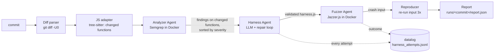

# ProofHound — Term 1 Architecture

Term 1 goal (weeks 1–14): a CLI that works end to end on JS/TS. Given a commit, it finds the
changed function, gets a SAST finding on it, has an LLM write a fuzz harness, fuzzes it in a
sandbox, and reports a **confirmed crash with a reproducing input**.

## 1. Scope

| In Term 1 | Deferred to Term 2 |
|---|---|
| Diff → changed functions (JS/TS) | Scheduler Agent (T1 fuzzes findings in severity order, fixed budget each) |
| Analyzer Agent (Semgrep, our taint rules) | Triage Agent (fusion score, PoV script, CVSS) |
| Harness Agent + repair loop (large model) | Patcher Agent |
| Fuzzer Agent (Jazzer.js in Docker) + crash reproduction | Small-model cascade in production runs |
| Orchestrator + CLI + JSON report | SARIF, MR comment, CI integration |
| Single-agent baseline | Continuous fuzzing across commits |
| Training-data logging of every harness attempt | Python adapter |
| Benchmark runner on 5–10 SecBench.js cases | Full benchmark and ablations |
| Pilot QLoRA Harness adapter (offline, on Colab) | |

Vulnerability classes in Term 1, in order: **command injection** first (demo case), then
**path traversal**. Both have built-in Jazzer.js bug detectors, so a "crash" means the detector
fired, not just any exception. Code injection, prototype pollution, and ReDoS come later.

## 2. Flow



The Orchestrator drives this sequence, owns the `Budget` (wall-clock + tokens), and writes
every intermediate artifact to `runs/<commit>/`.

## 3. Components

### 3.1 Diff parser — `vcs/diff.py`
- Input: repo path, commit SHA. Runs `git diff -U0 <commit>^ <commit>`.
- Output: `{file: set[changed_line]}` for `.js .mjs .cjs .ts` files only.
- Added/modified lines only; deletions are ignored in Term 1.

### 3.2 JS/TS adapter — `adapters/javascript.py`
- `extract_functions`: parses each file with **tree-sitter** (javascript / typescript grammars),
  returns every function whose body overlaps a changed line → `ChangedFunction`.
- Also records how the function is reachable: exported name and module path
  (`module.exports.x`, `export function x`, `export default`). The Harness Agent needs this to
  `require`/`import` the target.
- `harness_template()`: the Jazzer.js skeleton the LLM fills in.
- `fuzz_command()`: builds the Jazzer.js command line.

### 3.3 Analyzer Agent — `agents/analyzer.py`
- Runs Semgrep (`semgrep/semgrep` image) on the changed files with `rules/semgrep/javascript/`.
- Keeps only findings whose line falls inside a changed function.
- Rules are **taint rules** where the source is a parameter of an exported function (library
  code, as in SecBench.js) or request data (app code, as in NodeGoat), and the sink is e.g.
  `child_process.exec` or `fs.readFile`.
- Output: `list[Finding]` with `source`, `sink`, `severity`, and the attached `ChangedFunction`.
- No LLM in Term 1. The false-positive filter is a Term 2 item.

### 3.4 Harness Agent — `agents/harness.py`
LLM prompt contains: the function source, its export path, the finding (rule, source → sink),
the vulnerability class, and the harness template. The output is a single `harness.js`.

Validation ladder; each failure is fed back to the LLM as a repair prompt:

| Step | Check | Failure fed back |
|---|---|---|
| 1. Syntax | `node --check harness.js` | syntax error |
| 2. Load | run harness once on an empty input in the sandbox | require/import or runtime error |
| 3. Reach | the target function is called (probe counter injected by the harness template) | "target not reached" + the call path |
| 4. Coverage | short 5 s fuzz shows coverage growth in the target file | "no new coverage" |

- Up to `harness.large_model_repair_attempts` repairs (config, default 2), then the finding is
  reported as `harness_failed`.
- `Harness.attempts`, `compiled`, `reached_target` are filled in; `produced_by = "large"`.
- RQ1 is measured here: the same agent with the finding hints removed gives the "unguided"
  variant (config flag `harness.use_sast_hints`).

### 3.5 Fuzzer Agent — `agents/fuzzer.py`
- Runs Jazzer.js inside the sandbox for `budgets.fuzz_time_per_target_s` (default 30 s) with the
  bug detector for the finding's class enabled.
- Corpus per target in `corpus/<function-id>/` (kept on disk so Term 2 can reuse it).
- Parses Jazzer.js output for detector findings; saves the crash file and stack trace → `Crash`.
- **Reproducer**: re-runs the harness on the crash input 3 times. Only reproducible crashes are
  reported as confirmed. This is the Term 1 "reproducing input".

### 3.6 Sandbox — `sandbox/docker_runner.py`
- Image `proofhound/jazzerjs` (`docker/jazzerjs/Dockerfile`): Node 20 + Jazzer.js, non-root.
- `--network none`, `--memory 2g`, `--cpus 2`, `--pids-limit 256`, read-only target mount at
  `/work/target`, writable scratch at `/work/out`, hard timeout enforced from the host.
- Dependencies of the target are installed **once, before** the run, in a separate container
  that has network access; the fuzzing container never does.

### 3.7 LLM client — `llm/client.py`
- One `LLMClient` interface; Term 1 has one implementation for the large model.
- Every call returns text + token count; tokens are charged to the run `Budget`.
- Temperature, model id, and seed are logged per call (reproducibility).

### 3.8 Orchestrator — `orchestrator/pipeline.py`
- Sequential: diff → functions → analyzer → for each finding (by severity): harness → fuzz →
  reproduce. Stops cleanly when the budget is exhausted and reports what was skipped.
- Writes `runs/<commit>/` (see §6).

### 3.9 Single-agent baseline — `baseline/single_agent.py`
For RQ3. One LLM with the same model and the same tools exposed as function calls:
`read_file`, `git_diff`, `run_semgrep`, `write_harness`, `run_fuzzer`. A single prompt asks it
to find and confirm a vulnerability in the commit. Same budget, same report format, so the
two systems are compared on identical cases.

### 3.10 Training-data logger — `datalog/logger.py`
Appends one JSON line per harness attempt to `training/data/harness_attempts.jsonl`:

```json
{"case": "secbench/command-injection/xyz_1.0.0", "finding": {...}, "prompt": "...",
 "output": "...", "attempt": 2, "syntax_ok": true, "loaded": true, "reached": true,
 "coverage_gain": true, "crash_confirmed": true, "model": "...", "tokens": 1830}
```

Records with `reached = true` are the verified harnesses used for the pilot adapter.
Records from benchmark **evaluation** cases are tagged and excluded from training (no leakage).

### 3.11 Benchmark runner — `benchmark/`
SecBench.js gives a vulnerable npm package version, its vulnerability class, a sink location,
and an exploit. ProofHound needs a **commit**, so each case is turned into a two-commit git repo:

1. Commit A: the package at the **fixed** version (or with the vulnerable function reverted).
2. Commit B: the package at the **vulnerable** version → this is the commit we scan.

Ground truth = the SecBench.js sink location + exploit. A case is *detected* when ProofHound
confirms a crash of the right class whose stack trace reaches that sink.

Case manifest `benchmark/cases/<id>/case.yaml`: package, vulnerable version, fixed version,
class, sink file:line, split (`eval` | `train`).

### 3.12 Pilot Harness adapter — `training/notebooks/`
Offline, not in the runtime path: a Colab notebook that fine-tunes a small code model with
QLoRA on the verified harnesses from §3.10, then measures its first-attempt success on held-out
cases. Result reported in the Term 1 defense as a first number for RQ6.

## 4. Term 1 output — `runs/<commit>/`

```
runs/<commit>/
├── report.json            # summary + all findings and their status
└── <finding-id>/
    ├── finding.json       # Semgrep finding + changed function
    ├── harness.js         # final harness
    ├── attempts/          # every harness attempt + its error
    ├── crash-input        # reproducing input (if confirmed)
    ├── stacktrace.txt
    └── trace.json         # prompts, responses, tokens, timings
```

Finding status is one of: `confirmed`, `not_confirmed` (fuzzed, no crash),
`harness_failed`, `skipped_budget`.

## 5. Term 1 metrics
Harness success on first attempt and after repair, reach rate, detection rate on the 5–10
cases, time and tokens per commit, multi-agent vs single-agent, and the pilot adapter's
first-attempt success.

## 6. Tech choices

| Need | Choice | Why |
|---|---|---|
| Orchestrator | Python 3.11+ | Semgrep, Atheris (Term 2), and training are all Python |
| JS parsing | tree-sitter | Same parser approach works for Python in Term 2 |
| SAST | Semgrep in Docker | Taint mode; no native Windows install needed |
| Fuzzer | Jazzer.js | Coverage-guided, has injection/traversal bug detectors |
| Sandbox | Docker SDK for Python | Resource limits, no network |
| CLI | Typer | Already in the skeleton |

## 7. Build order

| Phase | Weeks | Build | Done when |
|---|---|---|---|
| T1-A | 1–3 | Literature notes; download SecBench.js; pick 5–10 command-injection/path-traversal cases | Case list + manifests |
| T1-B | 4–7 | Sandbox image; diff parser; JS adapter; Semgrep rules; Analyzer | `proofhound analyze` lists findings on changed functions of a case |
| T1-C | 8–11 | Hand-written harness on one known bug (no LLM) → Harness Agent + repair loop → Fuzzer + reproducer; datalog | One case confirmed end to end |
| T1-D | 12–14 | Orchestrator + `proofhound scan`; single-agent baseline; run all cases; pilot QLoRA | Term 1 numbers + defense demo |

## 8. Open decisions
- Large model provider and model id (needed before T1-C).
- Whether to add NodeGoat as a demo target in Term 1 (app code, request-data sources) or keep
  the demo on an injected case in a small library.
